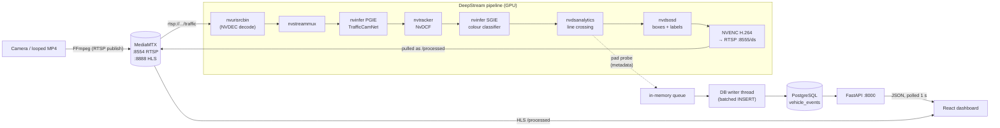

# Real-Time Vehicle Analytics Pipeline

An end-to-end computer vision system:

1. It ingests a live RTSP video stream.
2. It detects, tracks and colour-classifies vehicles on the GPU with **NVIDIA DeepStream**.
3. It counts vehicles that cross a virtual line and logs every crossing to **PostgreSQL**.
4. It shows live and historical analytics on a **React** dashboard, together with the annotated video.

| Layer | Technology |
|---|---|
| Video broker | MediaMTX (RTSP in, RTSP / HLS / WebRTC out) |
| Vision engine | DeepStream 7.1 (GStreamer) with Python bindings (`pyds`) |
| Detector (PGIE) | TrafficCamNet – ResNet18 DetectNet_v2, TensorRT INT8 |
| Tracker | NvDCF (`nvtracker`) |
| Colour classifier (SGIE) | ResNet18 fine-tuned on VCoR, ONNX → TensorRT FP16 |
| Line counting | `nvdsanalytics` (direction-aware line crossing) |
| Database | PostgreSQL 14+ |
| API | FastAPI |
| Frontend | React 18 + Vite, hls.js |

---

## 1. Architecture



### How data moves

1. **Ingestion.** FFmpeg publishes a camera feed (or a looped MP4) to MediaMTX at `rtsp://host:8554/traffic`. MediaMTX is the single broker, so any number of consumers (VLC, DeepStream, browser) can read the same stream.
2. **Decode and batch.** `nvurisrcbin` pulls the RTSP stream over TCP and decodes it on the GPU with NVDEC, reconnecting if the stream drops. `nvstreammux` scales frames to 1280×720 and forms batches. The batch size is 1 today; adding cameras means adding sources.
3. **Detect.** The primary `nvinfer` runs TrafficCamNet on every frame. Only the `car` class is kept.
4. **Track.** `nvtracker` (NvDCF) gives each vehicle a persistent `object_id` across frames, including through short occlusions.
5. **Classify colour.** The secondary `nvinfer` runs only on the PGIE's bounding boxes. Each box is cropped, resized to 224×224 and classified into 15 colours. `classifier-async-mode=1` classifies each track once and re-uses the result, which saves GPU time.
6. **Count.** `nvdsanalytics` checks whether a tracked object crossed the configured line, and in which direction (`in` / `out`).
7. **Persist.** A pad probe on the `nvdsanalytics` src pad reads the metadata (box, track ID, colour, crossing flag). On each new crossing it puts a `VehicleEvent` on a queue (non-blocking). A background thread inserts the queued events into PostgreSQL in batches, so the video thread never waits on the database.
8. **Visualise.**
   - `nvdsosd` draws the boxes, `#id colour` labels, the line and the running counters.
   - The frames are encoded with NVENC and served on an internal RTSP server.
   - MediaMTX pulls that stream as `/processed` and re-publishes it as HLS.
   - The React app polls the FastAPI endpoints every second and plays the HLS feed.

### Why each vehicle is counted exactly once
- The **tracker** keeps the same ID for a vehicle across frames.
- **nvdsanalytics** flags a crossing only on the frame where the track's trajectory crosses the line in the configured direction, using `mode=balanced` to ignore jitter on the line.
- The probe also keeps a set of `(source, track_id, line)` keys as a safety net, so the same track can't produce a second row.

---

## 2. Repository structure

```
├── mediamtx/mediamtx.yml          # broker config (paths: traffic, processed)
├── deepstream/
│   ├── app.py                     # pipeline + probe (core logic)
│   ├── db_writer.py               # async, batched PostgreSQL writer thread
│   └── configs/
│       ├── pgie_trafficcamnet.example.txt   # primary detector (real file is generated)
│       ├── tracker_config.txt               # NvDCF tracker
│       ├── sgie_color.txt                   # secondary colour classifier
│       └── nvdsanalytics.txt                # line-crossing (re-generated from --line)
├── color_classifier/train.py      # fine-tune ResNet18 on VCoR, export ONNX
├── models/color/                  # vehicle_color_resnet18.onnx + labels_color.txt
├── database/schema.sql            # vehicle_events table + indexes
├── backend/main.py                # FastAPI read API (+ serves the built dashboard)
├── frontend/                      # React dashboard (Vite)
├── scripts/                       # setup, DB init, start scripts, tmux launcher
└── docs/CLOUD_GPU_SETUP.md        # running on a rented GPU (no local NVIDIA GPU)
```

---

## 3. Prerequisites

- An **NVIDIA GPU** (Turing or newer) with driver **≥ 560** (DeepStream 7.1 / CUDA 12.6).
- **One of these** setups:
  - **Recommended:** the official container `nvcr.io/nvidia/deepstream:7.1-triton-multiarch`. This repo's `setup.sh` was written for it.
  - Ubuntu 22.04 with DeepStream 7.1 SDK, TensorRT 10 and CUDA 12.6 installed natively.
- No NVIDIA GPU locally? See **[docs/CLOUD_GPU_SETUP.md](docs/CLOUD_GPU_SETUP.md)**, which runs everything on a rented cloud GPU.

`scripts/setup.sh` installs everything else:

| Component | Installed how |
|---|---|
| FFmpeg, PostgreSQL, tmux, GStreamer RTSP server | `apt` |
| DeepStream Python bindings | `pyds-1.2.0` wheel (NVIDIA release for DS 7.1) |
| MediaMTX | latest Linux binary from GitHub releases → `bin/mediamtx` |
| Node.js 20 | NodeSource |
| Python packages | `deepstream/requirements.txt`, `backend/requirements.txt` |

---

## 4. Installation

```bash
# inside the DeepStream 7.1 container (as root)
git clone https://github.com/tejasprof84/vehicle-analytics.git
cd vehicle-analytics
cp .env.example .env            # DB credentials, input video, RTSP URL
bash scripts/setup.sh           # ~10 min: packages, pyds, MediaMTX, DB, dashboard build
```

### Colour classifier
DeepStream 7.x does not ship a colour model, so we trained one: ResNet18 fine-tuned for 6 epochs on the VCoR dataset (15 colours), **0.875 validation accuracy**.
The trained model is included in the repo (`models/color/`), so this step is **optional**. To re-train it (about 10 minutes on a GPU; a free Kaggle T4 notebook also works):

```bash
cd color_classifier
python3 -m venv .venv && source .venv/bin/activate
pip install -r requirements.txt
kaggle datasets download -d landrykezebou/vcor-vehicle-color-recognition-dataset -p data/vcor --unzip
python train.py --data-dir data/vcor --epochs 6
deactivate && cd ..
```

This writes `models/color/vehicle_color_resnet18.onnx` and `models/color/labels_color.txt`. See [color_classifier/README.md](color_classifier/README.md).

---

## 5. Running

### Everything at once
```bash
bash scripts/run_all.sh        # MediaMTX, FFmpeg, DeepStream, API in one tmux session
tmux attach -t vehicle         # watch the logs (Ctrl+B then D to detach)
```

### Or phase by phase (one terminal each)

| Phase | Command | Check |
|---|---|---|
| 1 Broker | `bash scripts/start_mediamtx.sh` | log shows `[RTSP] listener opened on :8554` |
| 1 Stream | `bash scripts/start_stream.sh [video.mp4]` | VLC → `rtsp://<host>:8554/traffic` |
| 2+3 Pipeline | `bash scripts/start_pipeline.sh` | `COUNT id=… colour dir=…` lines, FPS log |
| 3 DB | `psql -h 127.0.0.1 -U vehicle vehicle_analytics -c "SELECT * FROM vehicle_events ORDER BY id DESC LIMIT 5;"` | rows appear |
| 4 Dashboard | `bash scripts/start_backend.sh` | open `http://<host>:8000` |

The first pipeline start takes **1–3 minutes** because TensorRT builds the engines. Later starts reuse the cached `.engine` files.

### Endpoints

| URL | What |
|---|---|
| `rtsp://<host>:8554/traffic` | raw input stream |
| `rtsp://<host>:8554/processed` | annotated output (boxes, IDs, colours, line, counts) |
| `http://<host>:8888/processed/` | annotated output in the browser (HLS) |
| `http://<host>:8000` | React dashboard |
| `http://<host>:8000/docs` | interactive API docs (Swagger) |

### Pipeline options
```bash
python3 deepstream/app.py --help
  --uri          input RTSP URI                        (default rtsp://127.0.0.1:8554/traffic)
  --db-url       PostgreSQL DSN                        (default from $DATABASE_URL)
  --line         counting line x1,y1,x2,y2 (1280x720)  (default 0,430,1280,430)
  --sink         rtsp | fake (headless)                (default rtsp)
  --encoder      nvenc | x264 (GPUs without NVENC)     (default nvenc)
  --skip-color   run without the SGIE (debugging)
```

---

## 6. Pipeline configuration details

### `nvstreammux`
`width=1280 height=720 batch-size=1 live-source=1 batched-push-timeout=40000`. All coordinates (line, boxes) are in this 1280×720 space.

### Primary detector: `configs/pgie_trafficcamnet.txt`
- **Generated** by `scripts/prepare_pgie_config.py` from DeepStream's own `config_infer_primary.txt`, so model paths always match the installed SDK version. A reference copy is in `pgie_trafficcamnet.example.txt`.
- **Main settings:**
  - INT8 TensorRT
  - `batch-size=1`
  - `interval=0` (infer every frame)
  - `filter-out-class-ids=1;2;3` (keep vehicles only)
  - NMS clustering

### Tracker: `configs/tracker_config.txt`
- NvDCF low-level library with the SDK's `config_tracker_NvDCF_perf.yml`, running at 640×384.
- NvDCF combines visual correlation filters with motion prediction, so IDs survive brief occlusions. This matters for single counting.

### Secondary classifier: `configs/sgie_color.txt`

| Key | Value | Meaning |
|---|---|---|
| `process-mode` | 2 | operate on objects, not full frames |
| `operate-on-gie-id` / `operate-on-class-ids` | 1 / 0 | only boxes from the PGIE's car class |
| `network-type` | 1 | classifier |
| `net-scale-factor`, `offsets` | ImageNet normalisation | identical pre-processing to training |
| `classifier-async-mode` | 1 | classify once per track, reuse result |
| `input-object-min-width/height` | 40 | skip tiny boxes where colour is unreliable |
| `network-mode` | 2 | FP16 |

### Line crossing: `configs/nvdsanalytics.txt`
- Generated from `--line`.
- Each entry is `direction(x1;y1;x2;y2);line(x1;y1;x2;y2)`.
- Two entries share the same line with opposite direction vectors, `line-crossing-in` and `line-crossing-out`. The crossing label tells us the direction.
- `mode=balanced` filters out jitter around the line.

### Database writes: `deepstream/db_writer.py`
- The probe only calls `queue.put_nowait()`, so it never blocks the GStreamer thread.
- A writer thread flushes every 250 ms or every 50 events using `execute_values`, which batches many rows into one INSERT.
- It reconnects automatically and flushes any remaining events on shutdown.

---

## 7. Database schema

```sql
vehicle_events(
  id BIGSERIAL PK, vehicle_id BIGINT, vehicle_class TEXT, color TEXT, color_confidence REAL,
  direction TEXT, line_name TEXT, source_id INT, frame_number BIGINT,
  bbox_left/top/width/height REAL, event_time TIMESTAMPTZ  -- UTC, microsecond precision
)
-- indexes on event_time DESC, color, direction
```

Useful queries:
```sql
SELECT color, count(*) FROM vehicle_events GROUP BY color ORDER BY 2 DESC;
SELECT date_trunc('minute', event_time) m, count(*) FROM vehicle_events GROUP BY m ORDER BY m DESC LIMIT 10;
```

---

## 8. Dashboard

- **Live metrics:**
  - total count
  - in / out counts
  - count in the last 60 seconds
  - most common colour
  - time of the last crossing
- **Colour breakdown:** a bar per colour, with percentages.
- **History:** vehicles per minute, stacked in/out bars, with a range selector (15 min, 1 h, 24 h, all time).
- **Live table:** the 25 most recent crossings. New rows are highlighted.
- **Live video (bonus):** the DeepStream-annotated HLS stream from MediaMTX.

The dashboard refreshes through polling: metrics and the table every 1 s, the chart every 5 s. It works through any proxy or SSH tunnel and needs no WebSocket setup.

API: `GET /api/summary?minutes=`, `/api/events?limit=`, `/api/timeseries?minutes=`, `/api/health`.

---

## 9. Troubleshooting

| Symptom | Fix |
|---|---|
| `Unable to create element 'nvinfer'` | DeepStream not installed or not in the container. Run inside the DS 7.1 image. |
| `No module named pyds` | Re-run step 3 of `setup.sh` (pyds 1.2.0 wheel, Python 3.10). |
| Pipeline waits forever | Check that MediaMTX and FFmpeg are running: `ffprobe rtsp://127.0.0.1:8554/traffic`. |
| `nvv4l2h264enc` fails (A100/H100 have no NVENC) | Use `--encoder x264`. |
| No counts | Move the line with `--line` so that traffic actually crosses it. The line is drawn on `/processed`. |
| Colour always `unknown` | Boxes are smaller than 40 px, or the model is missing. Check `models/color/`. |
| First start is slow | Expected: the TensorRT engine is being built and is cached afterwards. |
